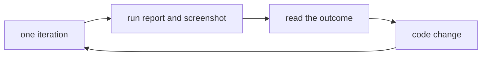

# Training

Training runs the app on its own, gives it a problem, and writes down what transcription and vision produced. The Python process then exits. The agent runs the command, reads the report for that iteration, and changes the code before the next one.

## Run it

```bash
uv run python main.py --train -n 3
```

`-n` is how many sessions to run. The default is 1. Each session is a new process, so one run cannot leave state behind for the next.

Other flags:

| Flag | Meaning |
|------|---------|
| `--timeout SECONDS` | How long one session waits for analysis. Default is 180. |
| `--seed NUMBER` | Makes the prompt choice repeatable. |

`python main.py --train -h` prints the same flags. A normal launch with no flags still opens the interactive app.

## What one iteration does

The parent in `train_mode.py` picks a prompt from `PROMPTS`. With `-n` at or below the length of that list, the prompts are distinct. A larger `-n` may repeat prompts.

The parent then starts `main.py --training-run` with that prompt and an output path. The child is the real window:

1. The window title is `agent-hoy training`.
2. For that process only, transcription is on, voice is off, vision is screen, and browser control is off. Those switches are not written to `conf/assist_mode.conf`.
3. The prompt is inserted as a transcript line. The microphone is not used.
4. Keyword analysis and the screen guide run the same way they do in a normal session.
5. The child waits until the AI pane has text, analysis is no longer running, and the text has been still for 2.5 seconds. It also waits at least 3 seconds so a slow start is not treated as a finished empty reply.
6. It captures its own window, writes the report and the PNG, and quits.

The parent waits `--timeout` plus 90 seconds for the child process. If the child never writes a report, the parent records a timeout and continues with the next prompt. `training/latest.md` is rewritten after every child, so a stopped command still has the sessions that finished.

## Following iterations

Run one session when the goal is to inspect and change the app before the next problem:

```bash
uv run python main.py --train -n 1 --seed 1
```

Then read `training/run-001.md` and `training/run-001.png`. The checks say whether the machinery worked. The transcript, AI pane, and screenshot say whether the answer was any good. Change the code from that evidence, then run the next iteration. Use the same `--seed` to repeat the prompt list, or a new seed to draw different problems.



## Reports

`training/` is gitignored.

| File | Contents |
|------|----------|
| `training/run-001.md` | One session: prompt, transcript, AI pane, topic pane, vision note, and checks. |
| `training/run-001.png` | The training window after the reply settled. |
| `training/latest.md` | Every session from the latest command, in order. |

A session passes only when all of these are true:

- The prompt text appears in the transcript.
- The AI pane is not empty.
- The AI pane does not start with an API, guide, or configuration error.
- A window image was captured.
- The wait did not time out.

The child exits 0 on a pass and 1 on a fail. The parent exits 1 if any child failed, and 2 if training is switched off. Exit 124 on a report means the child process itself exceeded the outer wait.

The checks are mechanical. They do not score whether the answer was good. Read the AI pane and the screenshot for that. `training/latest.md` collects every finished session from the current command.

## Code

| Piece | Role |
|-------|------|
| `train_mode.py` | Arguments, prompt list, the parent loop, the checks, and the report text. |
| `main.py` | `begin_training_run` injects the prompt, waits, captures the window, and quits. |
| `screen_capture.py` | `capture_window_by_id` grabs this app's window, which normal window share skips. |
| `test_train.py` | Argument parsing, prompt choice, and the report text. It does not open a window or call the API. |

`PROMPTS` in `train_mode.py` is the problem list. Add a line there to train on a new question.

## Rollback

Set `TRAINING_ENABLED` to `False` at the top of `train_mode.py`. `python main.py --train` then prints a short notice and exits 2. It does not open a window. Saved assist settings are left as they are.
