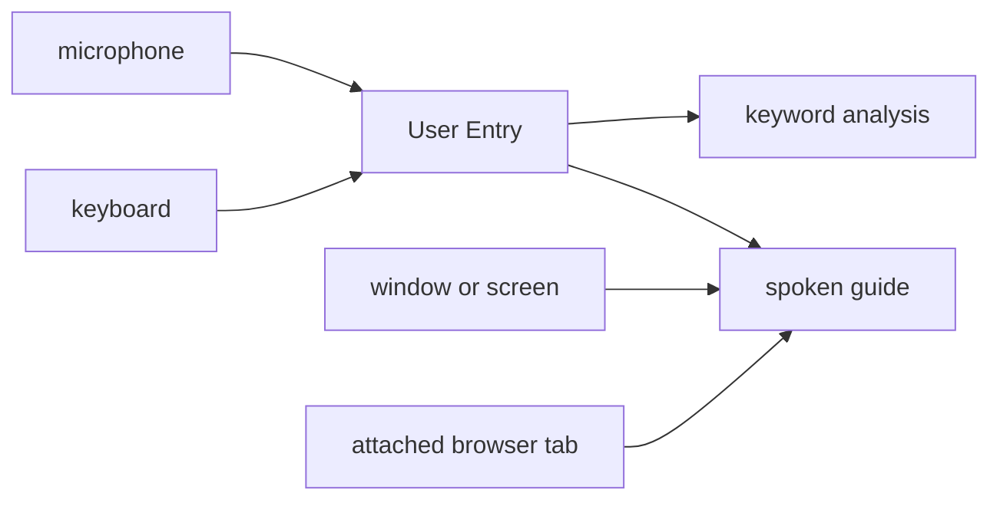

# agent-hoy

A desktop assistant for the machine you are sitting at. Speak or type into one pane. It can answer out loud, look at a window or the screen, read an Edge or Chrome page, remember a few facts, and take files in and out. The older keyword explanations are still there when Transcription is on.

Python 3.11. The window is tkinter. Models are called through the OpenAI SDK, including Grok on the xAI API.

## The window

The top pane is User Entry. The lower left pane is the assistant reply and keyword analysis. The lower right pane is the topic card for a highlighted term.

Live scroll, next to Enable AI Analysis, follows the newest line in the transcript and the analysis. Older text stays above it. Turn Live scroll off to park the view and read something earlier. The scrollbar still works either way. Set `LIVE_SCROLL_DEFAULT` to `False` in `main.py` to start parked.

Clear Text wipes the entry, the analysis, and the topic card for this session. Reset Cost zeros the session cost counter.

## Speaking and typing

Start Listening turns the microphone on. Stop Listening turns it off. Pause Listening holds the microphone and leaves analysis free to finish.

Transcription has to be checked for speech to land in User Entry. While that is on and the mic is actually listening, the pane belongs to speech and keystrokes are ignored. The short pause while the app is speaking does not open the keyboard.

The keyboard is how you write when any of these is true:

- Transcription is unchecked
- Listening is stopped
- Listening is paused

Type at the end of the pane. Enter sends the draft through the same path as a spoken line. Shift+Enter inserts a line break. Backspace stops at text that was already sent. Set `USER_ENTRY_ENABLED` to `False` in `main.py` to put the pane back to Live Transcription with no typed send.

## Assist controls

Transcription, Voice, and Vision can be on together.

| Control | What it does |
|---------|----------------|
| Transcription | Keyword highlights, topic cards, and the written analysis. This is the behavior the app had before voice and vision. |
| Voice | Speaks the conversational reply. It does not read the keyword essay aloud. |
| Vision | Off, Window, or Screen. One share source at a time. |
| Control browser | Off until checked. Click, type, press, scroll, and navigate in an attached Edge or Chrome tab. |

Window shares the foreground window, or the last window that was in front of this app. This app's own window is skipped. Screen shares the display under the pointer.

Screenshots go out at the captured resolution. The image is reduced only when the API would reject it, or when the file is still too large after a high-quality JPEG at the same pixel size.

Voice uses the marin voice of `gpt-4o-mini-tts` and a calm speaking style. The microphone pauses while that audio plays. Recent turns go out with each new utterance. When you say you, you mean the assistant. The reply is a conversation. Technical help is available when that is the question. It is not assumed.

On Linux with Wayland, capture goes through the desktop screenshot portal. Window asks that portal which window to share. macOS needs Screen Recording permission for the terminal that launched the app.



## Models and keys

The Model menu lists the GPT models first, then Grok 4.3 and Grok 4.7, then LM Studio. The choice is saved in `conf/openai_model.conf`. `OPENAI_MODEL` still wins over that file on startup.

GPT models use an OpenAI key. Grok models do not. A Grok model needs an xAI key or the call fails. LM Studio does not need a key. It uses the model you have loaded in LM Studio's local server.

Keys are read from `ai_provider_keys.txt` in the project folder:

```
openai =
grok =
```

Paste the secret after the name. A later provider is another `name = key` line. The file is gitignored. `ai_provider_keys.txt.example` shows the shape with empty values.

If the `openai` or `grok` line is empty, the app still checks the environment and the older files:

| Provider | Environment | Older file |
|----------|-------------|------------|
| OpenAI | `OPENAI_API_KEY` | `openai_key.txt` |
| Grok | `XAI_API_KEY` | `xai_key.txt` |

Restart after saving a key. The status line names the provider. For Grok with no key it says to add the key to `ai_provider_keys.txt`.

Grok calls go to `https://api.x.ai/v1` with Chat Completions. GPT calls use the Responses API unless `USE_RESPONSES_API` is false. LM Studio calls go to `http://127.0.0.1:1234/v1` with Chat Completions, using the model that server reports as loaded. Start that server and load a model before you select LM Studio. If the server uses another port, set `LMSTUDIO_BASE_URL`. Voice still asks OpenAI for speech, so leave Voice off while LM Studio is selected. A screenshot is sent only when Vision is on, and the loaded model has to accept images.

Answers are asked to stay direct. Set `DIRECT_ANSWERS` to `False` in `openai_config.py` to restore the long technical-expert prompt. Set `GROK_MODELS_ENABLED` to `False` there to drop Grok from the menu. Set `LMSTUDIO_ENABLED` to `False` there to drop LM Studio from the menu. Set `PROVIDER_KEYS_FILE_ENABLED` to `False` to ignore `ai_provider_keys.txt` and use only the environment and the older key files.

## Files

Add files attaches text for context. Up to 8 files, 1 MB each, with a cap on how much text is sent. Binary files are named and not inlined. Clear files drops them. The label shows what is attached.

A file is written only when you ask for one. The reply names it. The body is saved under `output/`, which is gitignored, and stripped from what is spoken. Download copies that file to a place you choose. If several files were saved, a list asks which one. Download stays disabled until a file exists.

Set `FILE_EXCHANGE_ENABLED` to `False` in `file_exchange.py` to remove Add files, Clear files, and Download.

## Memory

Durable facts can be stored in `memory/agent_memory.md`. That directory is gitignored. The file is read on the next turn. Memory lines are not shown and not spoken. Duplicates are skipped. The file keeps at most 100 lines.

Set `MEMORY_ENABLED` to `False` in `memory_store.py` to stop reading and writing without deleting the file.

## Browser pages

When the shared window is Edge or Chrome, and that browser was started with a debugging port, the guide reads the page text and a full-page image when the image fits the size rules. If the image is too large, the guide gets the text and a note that the image was too large. If the port is missing, the status line gives one relaunch command. A browser that is already open cannot be attached. Other windows stay screenshots.

Control browser starts off. Set `BROWSER_CONTROL_ENABLED` to `False` in `browser_bridge.py` to remove the checkbox and the actions.

## Training

`uv run python main.py --train -n 3` runs the app on its own, once per problem, and writes a gitignored report under `training/`. Voice stays off. The window is kept in front for the run. Set `TRAINING_WINDOW_ONTOP` to `False` in `main.py` to leave it behind other windows. Set `TRAINING_ENABLED` to `False` in `train_mode.py` to disable the command.

The checks in the report are mechanical. Whether the answer was any good is a separate reading of the transcript, the panes, and the screenshot. The loop, the flags, and the report files are written up in [DEVELOPER.md](DEVELOPER.md).

## Install

### Prerequisites

- [uv](https://github.com/astral-sh/uv)
  - Linux or macOS: `curl -LsSf https://astral.sh/uv/install.sh | sh`
  - Windows: `powershell -c "irm https://astral.sh/uv/install.ps1 | iex"`
- Python 3.11, installed by uv from `.python-version`

### Profiles

| Profile | Command | Size | Speech recognition |
|---------|---------|------|-------------------|
| Lite, the default | `uv sync` | about 50 MB | Google Speech, needs FLAC and a network |
| Full, offline | `uv sync --extra whisper` | about 1 to 2 GB | Whisper first, Google as fallback |

`uv sync` without `--extra whisper` installs Lite and removes Whisper. After a Full install, use `run.bat` or sync with `--extra whisper` again.

### Quick start

```bash
git clone <repository-url>
cd agent-hoy

./setup_uv.sh          # Linux or macOS, Lite
setup_uv.bat           # Windows, Lite

./setup_uv.sh --full   # offline Whisper
setup_uv.bat --full
```

Manual:

```bash
uv python install 3.11
uv sync
# or: uv sync --extra whisper

uv run python test_setup.py
uv run python main.py
```

Launchers that re-sync the selected profile first:

```bash
run.bat
./run.sh
```

### System packages

| OS | Lite | Full, in addition |
|----|------|-------------------|
| Linux | `portaudio19-dev`, `python3-tk`, `flac` | `ffmpeg` |
| macOS | `portaudio`, `flac` | `ffmpeg` |
| Windows | `choco install flac` | `choco install ffmpeg` |

```bash
sudo apt-get install portaudio19-dev python3-tk flac ffmpeg
brew install portaudio flac ffmpeg
```

### GPU Whisper

`setup_uv.sh --full` and `setup_uv.bat --full` detect an NVIDIA GPU and install the CUDA PyTorch wheels. By hand:

```bash
uv sync --extra whisper
export TORCH_CUDA_INDEX_URL="${TORCH_CUDA_INDEX_URL:-https://download.pytorch.org/whl/cu130}"
uv pip install --force-reinstall torch torchaudio --index-url "$TORCH_CUDA_INDEX_URL"
```

`cu126` is the rollback index for older drivers. With CUDA, the app prefers Whisper. Without it, Google Speech is preferred while online, and CPU Whisper is the offline fallback.

### Config files

Shipped defaults are `conf/*.conf.example`. Copy one to the matching `conf/*.conf` name to override it. Those copies are gitignored.

```bash
cp conf/corrections.conf.example conf/corrections.conf
cp conf/tech_keywords.conf.example conf/tech_keywords.conf
```

The same pattern covers topic explanations, question patterns, question type patterns, and `openai_model`. Delete the `conf/*.conf` file to fall back to the example.

Assist choices are stored in `conf/assist_mode.conf`.

## Environment

| Variable | Default | Role |
|----------|---------|------|
| `OPENAI_API_KEY` | none | OpenAI key when `ai_provider_keys.txt` has no openai line |
| `XAI_API_KEY` | none | xAI key when `ai_provider_keys.txt` has no grok line |
| `OPENAI_MODEL` | `gpt-4.1-mini` | Startup model. Overrides the saved menu choice. |
| `USE_RESPONSES_API` | `true` | Responses API for GPT. `false` uses Chat Completions. Grok and LM Studio always use Chat Completions. |
| `LMSTUDIO_BASE_URL` | `http://127.0.0.1:1234/v1` | LM Studio local server. |
| `OPENAI_STREAM` | `true` | Stream GPT replies into the pane |
| `OPENAI_REASONING_EFFORT` | `low` | Effort for GPT-5 and for Grok |
| `OPENAI_TEXT_VERBOSITY` | `medium` | Verbosity for GPT-5 reasoning models |
| `STT_PREFER_GOOGLE` | `false` | Google Speech even when CUDA is available |
| `STT_PREFER_WHISPER` | `false` | Whisper even without CUDA |
| `WHISPER_MODEL` | auto | `base` on CPU, `small` on GPU |
| `WHISPER_FAST_MODE` | `true` | Greedy decoding and shorter prompts |
| `WHISPER_BEAM_SIZE` | `1` | Higher is slower and more accurate |
| `TORCH_CUDA_INDEX_URL` | cu130 index | CUDA wheel index. Rollback value is the cu126 index. |
| `QUESTION_COMPLETION_TIMEOUT` | `1.5` | Seconds after speech before analysis runs |
| `AI_ANALYSIS_THROTTLE_SECONDS` | `2` | Minimum gap between model calls |
| `LISTEN_PHRASE_TIME_LIMIT` | `3` | Max seconds per microphone chunk |
| `VERBOSE` | `false` | Debug logging |
| `RECOGNITION_MAX_WORKERS` | `2` | Parallel speech-to-text workers |
| `NETWORK_CHECK_TTL_SECONDS` | `30` | How long a network check is cached |

More detail: [OPENAI_SETUP.md](OPENAI_SETUP.md), [OFFLINE_SETUP.md](OFFLINE_SETUP.md), [INSTALLATION_GUIDE.md](INSTALLATION_GUIDE.md), [DEVELOPER.md](DEVELOPER.md).

## Rollback switches

| Switch | File | Off means |
|--------|------|-----------|
| `ASSIST_MODES_ENABLED` | `assist_mode.py` | No Transcription, Voice, or Vision controls. Transcription only. |
| `USER_ENTRY_ENABLED` | `main.py` | The top pane is Live Transcription again. |
| `LIVE_SCROLL_DEFAULT` | `main.py` | The view starts parked. |
| `DIRECT_ANSWERS` | `openai_config.py` | The long technical-expert prompt is back. |
| `GROK_MODELS_ENABLED` | `openai_config.py` | Grok is gone from the menu. |
| `LMSTUDIO_ENABLED` | `openai_config.py` | LM Studio is gone from the menu. |
| `PROVIDER_KEYS_FILE_ENABLED` | `openai_config.py` | `ai_provider_keys.txt` is ignored. |
| `MEMORY_ENABLED` | `memory_store.py` | Memory is not read or written. The file stays. |
| `BROWSER_CONTROL_ENABLED` | `browser_bridge.py` | No Control browser checkbox and no page actions. |
| `FILE_EXCHANGE_ENABLED` | `file_exchange.py` | No Add files, Clear files, or Download. |
| `TRAINING_ENABLED` | `train_mode.py` | `--train` exits without a window. |
| `TRAINING_WINDOW_ONTOP` | `main.py` | The training window is not forced in front. |
| `TTS_VOICE`, `TTS_INSTRUCTIONS` | `voice_output.py` | Voice name and speaking style. `coral` is the previous voice. |
| `DIRECT_HOWTO_ANSWERS` | `main.py` | How-to and definition questions use the long troubleshooting essay. |
| `ALWAYS_SHOW_BOOT_PROCESS` | `main.py` | Linux topic cards include the boot writeup for every question. |
| `DESCRIBE_APP_CONTROLS` | `assist_mode.py` | The guide is not told how Live scroll works. |

## Troubleshooting

Recreate a Lite environment:

```bash
rm -rf .venv
uv sync
```

On Windows that removal is `rmdir /s /q .venv`.

Move to Full:

```bash
uv sync --extra whisper
```

PyAudio: install the system portaudio package, then `uv sync --reinstall-package pyaudio`.

Microphone: check the operating system permission, and that no other program holds the device.

Diagnostics: `uv run python test_setup.py`

## Smoke checklist

- [ ] `uv run python test_setup.py` passes
- [ ] `uv run python test_assist.py` passes
- [ ] `uv run python test_train.py` passes
- [ ] `uv run python test_openai.py` passes, or template fallback with no key
- [ ] `uv run python main.py` opens the window
- [ ] User Entry accepts typing when listening is stopped, and Enter sends the line
- [ ] Start Listening with Transcription on writes speech and ignores typing
- [ ] Pause Listening accepts typing again
- [ ] Live scroll follows the end, and turning it off leaves the view where it is
- [ ] Transcription, Voice, and Vision can be on together
- [ ] Control browser is present and off until checked
- [ ] Window or Screen keeps a native-resolution screenshot
- [ ] Add files shows a name, and Download stays off until a file is produced
- [ ] The Model menu lists the GPT models, then Grok 4.3 and Grok 4.7, then LM Studio
- [ ] Lite: Google Speech transcribes, with FLAC and a network
- [ ] Full: Whisper transcribes offline

## License

MIT. See [LICENSE](LICENSE).
